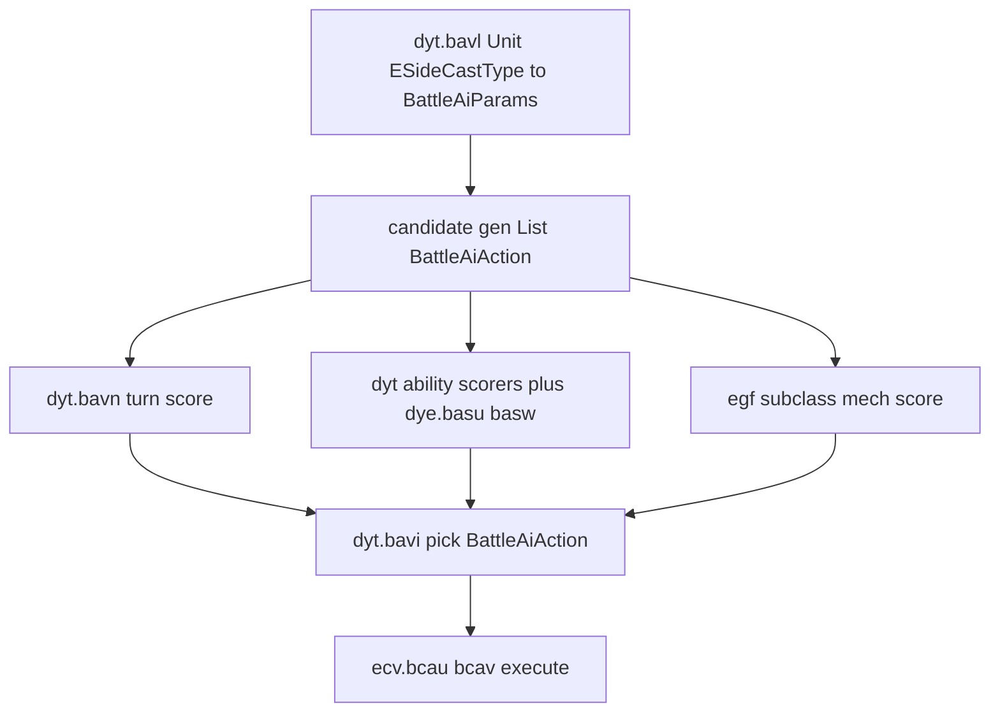
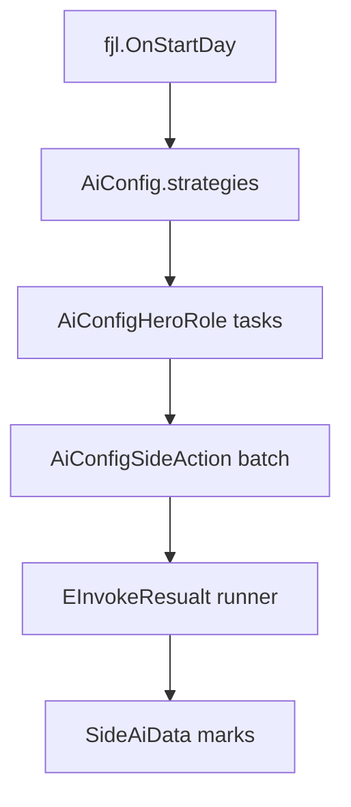

# Olden Era AI Decision Logic Surface

Date: 2026-07-11  
Evidence: **source/static validated** against Golden Era DummyDll  
`tools/il2cpp_out_golden_era_current/DummyDll/Hex.dll` via ILSpy.  
Runtime Harmony proof: **unvalidated** until `homm3_battle_ai_decision_probe.flag` observes live picks.

Working ILSpy dumps: `tmp/ai_decision_decomp/` (`dyt.cs`, `dye.cs`, `ecv.cs`, `egf.cs`, `fjl.cs`, …).

## Verdict

Battle decision logic is hookable on **`dyt`**. Adventure AI is a JSON-driven state machine with a clear daily entry (`fjl.OnStartDay`). This pass ships symbols + a **read-only** battle picker probe only.

## Naming correction (do not trust May-2026 CSV for this)

| Role | Stale May CSV | Current GE DummyDll |
|------|---------------|---------------------|
| Battle AI brain | `dyn` | **`dyt`** |
| Static scorers | `dxy` | **`dye`** |
| Ability runtime (NOT scorers) | — | **`dxy`** (also `BattleAiAction.ability`) |
| Action executor | `eco` | **`ecv`** |
| Final pick | `baul` / `bauk` | **`bavi`** (+ aliases `mla`, `kkj`) |
| Turn score | `bauq` / `baup` | **`bavn`** |
| Params load | `bauo` / `baun` | **`bavl`** (+ aliases) |
| Execute | `bbzt` family | **`bcau` / `bcav`** |

Live BepInEx interop often renames short obfuscated types to `ObjectPublic*`. Readable types remain for `Hex.Session.Battle.BattleAiAction`, `Hex.Configs.BattleAiParams`, and `Hex.Configs.AiConfig*`. Resolve hooks by **signature**, never short name alone.

Interop string evidence for the picker:

`Method_Private_BattleAiAction_Unit_List_1_Unit_List_1_Unit_List_1_BattleAiAction_0`

## Battle decision loop

### Action shape (`BattleAiAction`)

Fields: `identified`, `value`, `caster`, `hexToAttack`, `hexToRun`, `ability` (`dxy`), `magic`, `heroAbility`, `bestHexValue`, `bestAttackValue`, `actionType`.

`EAiActionType`: `Unknown`, `UnitMove`, `UnitAbility`, `HeroAbility`, `Magic`.

### Params bag (`BattleAiParams`)

JSON-backed weights from `DB/ai_battle/*`: aggression, danger, kill/target values, `topAbilityCasts`, `topMagicCasts`, `topHeroAbilities`, `mechValues`, `trapHexValue`, multipliers, transitions, per-unit damage multipliers. Loaded per unit via `dyt.bavl`.

### Highest-leverage battle hooks

1. **`dyt.bavi(Unit, List&lt;Unit&gt;, List&lt;Unit&gt;, List&lt;BattleAiAction&gt;) → BattleAiAction`** — final policy choke point.
2. **`dyt.bavn(Unit, BattleAiParams, List&lt;Unit&gt;, List&lt;Unit&gt;, Dictionary&lt;int,int[]&gt;, Dictionary&lt;Unit,float&gt;) → int`** — turn scoring.
3. **`dye.basu` / `dye.basw`** — buff/damage static scorers.
4. **`egf` mech scorers** — per-mechanic ability AI.
5. **`ecv.bcau` / `bcav(BattleAiAction, int)`** — execution observe/block only.
6. **Postfix mutate `BattleAiParams` from `bavl`** — runtime weight override without Core.zip edit.

Also present: static debug bools on `dyt` (`cejo`…`cejr`) and `AiDebugEventArgs`.

## Adventure decision loop

Lookahead design (mark-centric + omniscient): [`ai_lookahead_requirements.md`](ai_lookahead_requirements.md).

`DB/ai_world/*` owns strategy/action SIDs; code owns pathing/scoring/execution.

## Mod surface in this repo

| Artifact | Role |
|----------|------|
| `GameSymbols.BattleAiDecision` | Signature-stable type/method hints |
| `GameSymbols.AdventureAiDecision` | Day controller / locator / `SideAiData` mark hints |
| `Homm3BattleAiDecisionProbe` | Flag-gated read-only battle picker postfix |
| `homm3_battle_ai_decision_probe.flag` | Enables the battle probe |
| `Homm3AdventureLookaheadState` | Planner-owned mark-centric fork DTO (`Clone`, live Side capture) |
| `Homm3AdventureAiDecisionProbe` | Flag-gated read-only `fjl.OnStartDay` postfix (snapshot log only) |
| `homm3_adventure_ai_decision_probe.flag` | Enables the adventure probe |
| `OldenAiSim` (`tools/olden_ai_sim`) | External VCMI-inspired adventure simulator DLL |
| `Homm3AdventureAiWeightBridge` | Day-start Evaluate + `ffe.bjsj` score bias |
| `homm3_adventure_ai_weight_bridge.flag` / `homm3_adventure_ai_weight_apply.flag` | Register bridge / mutate scores |
| `tools/validate_battle_ai_decision_surface_contract.py` | Battle surface static contract |
| `tools/validate_adventure_ai_lookahead_surface_contract.py` | Adventure lookahead static contract |
| `tools/validate_olden_ai_sim_contract.py` | Sim isolation + weight bridge contract |

## Drift hazards

- **`dxy`**: ability runtime in current GE; scorers are **`dye`**. Counterstroke/law hooks that mention readable `dxy` are ability execution, not AI policy.
- **`dyn`**: obstruction variant code in current DummyDll — not Battle AI.
- Method ordinal aliases (`bavi`/`mla`/`kkj`) share the picker signature; prefer signature match + hint ranking.
- DummyDll stubs have empty bodies; ISIL/native disasm is required for algorithm internals beyond signatures.

## Evidence labels

| Claim | Label |
|-------|-------|
| `dyt`/`dye`/`ecv` ownership and picker/score/exec signatures | source/static validated (DummyDll ILSpy 2026-07-11) |
| Interop picker method-name string | source/static validated (live Hex.dll string scan) |
| Harmony postfix observes live AI picks | runtime-unvalidated |
| Adventure `fjl.OnStartDay` + mark-centric DTO | source/static validated; Harmony probe registered, runtime-unvalidated |
| Adventure mark writeback / beam search | not implemented |
