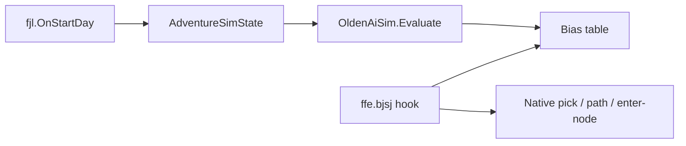

# External Adventure AI Sim + Score Weights

Date: 2026-07-18  
Evidence: **source/static** for hooks; sim is pure managed logic (no Unity).  
Runtime weight application: **unvalidated** until Golden Era flag smoke.

Parent: [`ai_lookahead_requirements.md`](ai_lookahead_requirements.md), [`ai_homm55_parity_investigation.md`](ai_homm55_parity_investigation.md).  
Leave-off / next gap (live hero-local map capture): [`ai_sim_live_map_capture_handoff_2026-08-02.md`](ai_sim_live_map_capture_handoff_2026-08-02.md).

## Locked product shape

| Decision | Choice |
|----------|--------|
| Write path | Adventure **task score weights** via Harmony on `ffe.bjsj` |
| Sim host | Separate managed DLL [`tools/olden_ai_sim`](../tools/olden_ai_sim) (`OldenAiSim`) |
| State | Mark-centric + omniscient export |
| Mechanics base | VCMI-inspired formulas, adapted for Olden; **ask the user** when Core/DummyDll cannot prove a rule |



## Public API (`OldenAiSim`)

- `AdventureSimState` — day, side, heroes, resources, marks, sparse occupancy, pathability grid
- `AdventureSimKnobs` — beam depth/width, time budget, fight thresholds
- `AdventureSimResult` — preferred target kind/id + `BiasEntry[]` multipliers
- `AdventureSimulator.Evaluate(state, knobs) → result`

**Contract:** zero references to `HarmonyLib`, `UnityEngine`, `BepInEx`, or `Hex` game assemblies. Enforced by `tools/validate_olden_ai_sim_contract.py`.

## Mod bridge

| Artifact | Role |
|----------|------|
| `Homm3AdventureLookaheadState` | Live capture → maps into `AdventureSimState` |
| `Homm3AdventureAiWeightBridge` | Day-start Evaluate + bias cache; `ffe.bjsj` postfix |
| Flags | `homm3_adventure_ai_weight_bridge.flag` (register); `homm3_adventure_ai_weight_apply.flag` (mutate scores) |

Without apply flag: log-only (sim choice vs native score). With apply: multiply `__result` when candidate matches a bias key.

## Sim modules (world model v2)

1. **Graph** — 4-neighbor Dijkstra; when `MoveCost` length-matches the grid it is the **sole** cell-cost authority (committed Core tile/road ints under `tools/olden_ai_sim/data/`). Portals are node-indexed; alive occupancy blocks pathing except the visit target.
2. **Fight estimate (provisional)** — `Σ(stacks × unitValue)` vs `startValue`, with `HeroPowerMultiplier` / `ValuesVsMobsMultiplier` knobs. Not `fda.bjeg` fidelity.
3. **Economy** — EOD gold = `DailyGoldIncome` (base) + owned mine `GoldReward`; capture sets `OwnerSide`.
4. **Beam** — typed kinds `MoveToOccupy | MarkSet | TownBuild | TownHire | TownGarrisonTake | EndDay`; town/mark/end-day skip Dijkstra. Core `ai_world` SID JSON is **reference only** (`wiredToBeam: false`).
4b. **Town management (provisional)** — `AdventureSimTown` + catalog builds/hires; owned-town daily gold; capture creates town state. Costs are **not** Core-proven.
5. **Stepper** — `AdventureSimStepper` records inspectable `StepRecord`s; Evaluate wraps it.
6. **Import** — clipped `.aisim` fixture + `AdventureSimMapImport` (full 80×80 not a smoke proof).

## Offline GUI workbench (step-debug)

```bash
dotnet run --project tools/olden_ai_sim/gui/OldenAiSim.Gui.csproj
```

**Evaluate** then **Step back / Step forward / Run to end / Reset**. Inspectors (World, Action, Candidates, Fight, Biases) sync to the current step. Paint is locked mid-session (Reset first). Map shows roads, portals, ownership tints, path, and reach overlay.

## Ask-when-uncertain

Do not invent Olden-unique rules. Stop and ask when:

- Native `penalty` / road `bonus` → `worldMovePoints` consumer formula differs from the provisional extract (`stepMp = round(100 * penalty / 0.4)`)
- Army strength should use `fda.bjeg` vs `squadValue`×count
- `bjsj` candidate identity fields (`cjqs`/`cjqt`/`fcp`) prove insufficient to key biases

## Offline smoke

```bash
python tools/olden_ai_sim/smoke_offline.py
```

Builds library + unit tests + GUI project, then runs sim/lookahead contract validators. Does **not** require Core.zip or launch Olden Era.

## Golden Era runtime checklist

1. Build/deploy OfflineUnlockMod so `OldenAiSim.dll` sits beside the plugin.
2. Create `homm3_adventure_ai_weight_bridge.flag` (register hooks).
3. Optionally create `homm3_adventure_ai_weight_apply.flag` (mutate scores; omit for log-only).
4. Start a match with computer players; on AI day start expect log lines:
   - `HoMM3 adventure AI weight bridge day`
   - `HoMM3 adventure AI weight bridge score`
5. Confirm `RegistrationAuditStatus` contains `RUNTIME_HOOK_REGISTERED`.

## Non-goals (v1)

Fog-faithful search, town build trees, spellbooks, L2 `eeo` combat, rewriting `fjg.Invoke` / enter-node.
