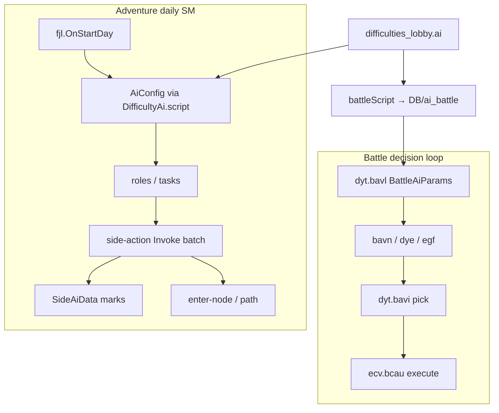
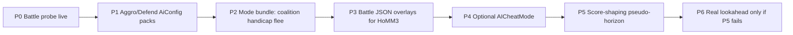

# Heroes 5.5 AI Surfaces → Olden Era Feasibility

Date: 2026-07-11  
Evidence: **source/static** (Golden Era Core.zip, DummyDll ILSpy, repo symbols/docs).  
Runtime Harmony for adventure AI: **unvalidated**. Battle picker probe: **registered, runtime-unvalidated**.

This investigation maps every major Heroes 5.5 (MMH5.5 / Quantomas) AI behavioral control onto Olden Era, and describes how we might approximate it.

## Heroes 5.5 control catalog

| # | 5.5 surface | What it does |
|---|-------------|--------------|
| A1 | **Lookahead depth** | Multi-day adventure search budget (smarter / slower) |
| A2 | **Aggressive / Defensive** | Explore+hunt vs stay-in-zone (per AI player) |
| A3 | **Casual / Default / Savage / Nightmare** | Flee rules, AI coalition vs human, bank growth, loot rules |
| A4 | **AICheatMode 0–6** | Post-combat creature replenishment to offset combat-AI losses |
| A5 | **Handicap** | Explicit weaken-AI dial |
| A6 | **Difficulty economy** | Start resources, neutrals, XP, bank growth |
| A7 | **All-AI vs human** | Forced coalition (`@H55_ChallengeMe`) |
| B1 | **Combat decision policy** | Melee leave shooters, target summons/machines, evade junk |
| B2 | **Spell/ability anti-spam** | Contextual cast gates + weights |
| B3 | **Quick-combat loss correction** | Auto-resolve fairness / cheat replenish |
| B4 | **Per-difficulty combat profiles** | Different combat AI packs by difficulty |
| B5 | **In-battle “lookahead”** | Multi-pass / future danger (5.5 code; Olden has weight-only Future fields) |
| C1 | **ARMG army blueprints** | Sensible neutral/AI stack mixes |
| C2 | **Algebraic multi-pass planner** | Offensive/defensive/balanced/predicted-opponent passes |

Sources: [Quantomas AI writeup](http://www.bonddisc.com/ref/h5/ai.htm), [MMH5.5 difficulty settings](https://www.moddb.com/mods/might-magic-heroes-55/tutorials/mmh55-difficulty-settings), combat AI release notes.

---

## Olden architecture (reminder)

No multi-day adventure search tree or `lookahead` field exists in Core/`Hex.dll` (string scan 2026-07-11).

---

## Feasibility matrix

| ID | 5.5 surface | Olden closest surface | Approach | Effort | Risk | Verdict |
|----|-------------|----------------------|----------|--------|------|---------|
| **A1** | Lookahead depth | **None** | See dedicated section below | Very high | Very high | **Not native; shim ≈ rewrite** |
| **A2** | Aggro / Defend | `DB/ai_world/ai/*.json` scripts + `difficulties_lobby.ai[].script` | Author aggressive vs defensive `AiConfig` packs; point lobby tiers / per-side override at them. Optional Harmony prefix on `fjl.OnStartDay` to swap `AiConfig` | Low–medium | Low | **High ROI, data-first** |
| **A3** | Casual/Savage modes | Partial: flee not in `ai[]`; alliance is session/team | New lobby/mode flags + Harmony on flee/diplomacy + team assignment. Bank growth via guard/squad multipliers | Medium | Medium | **Composable from parts** |
| **A4** | AICheatMode | No post-combat replenish in Core | Harmony after battle result → bump AI stacks by % | Medium | High (masks balance) | **Opt-in cheat only** |
| **A5** | Handicap | `ai_side_buffs`, `resourceAddPercent`, `tempStacksMultiplier`, `heroPowerMultipler` | Overlay buffs / lobby multipliers | Low | Low | **Already data-feasible** |
| **A6** | Economy difficulty | `difficulties_lobby` economic/squad/guard + `difficulties.json` | Core overlay / start-info indices | Low | Low | **Already exists** |
| **A7** | AI coalition | Session teams / diplomacy | Set all AI on one team vs human at match start (Plugin / bridge) | Low–medium | Low | **Feasible without AI rewrite** |
| **B1** | Combat policy | `BattleAiParams`, unit `ai` tags, special creature packs, `dyt.bavi` | Tune JSON first; Harmony re-rank on picker for H5.5-exact cases | Low–medium | Medium | **Strong data surface** |
| **B2** | Ability anti-spam | `topAbilityCasts`, `mechValues`, magic profiles | Overlay + optional `egf`/`bavi` context gates | Low–medium | Medium | **Strong data surface** |
| **B3** | QC loss correction | Same as A4 for auto-battle | Post-sim `TransferBattle` adjust | Medium | High | **Cheat, not intelligence** |
| **B4** | Combat difficulty packs | `battle_ai_{simple,normal,hard}` + magic variants | Already first-class; wire lobby→profile if needed via `bavl` | Low | Low | **Done in engine** |
| **B5** | Battle lookahead | `*Future` / `danger*` weights only | Tune weights; no depth slider | Low | Low | **Partial only** |
| **C1** | Army blueprints | Squads / `squadValue` / RMG pools (`DB/ai_pick`) | Content + templates | Low–medium | Low | **Content work** |
| **C2** | Multi-pass planner | Daily SM + roles | Emulate via strategy scripts, not real multi-pass search | Medium | Medium | **Approximate only** |

---

## A1 — Lookahead depth (deep dive)

**Full requirements breakdown:** [`ai_lookahead_requirements.md`](ai_lookahead_requirements.md) (L0 pseudo-horizon / L1 abstract search + autobattle heuristic / L2 isolated `eeo` sims).

### What 5.5 does
Quantomas evaluates hero action trees for N days with pruning, path caching, and multi-pass offensive/defensive balancing. Depth is a user knob on `MMH55_64.exe`.

### What Olden does
1. **One day tick:** `fjl.OnStartDay` (DummyDll-confirmed) drives roles/tasks/actions.
2. **Same-day multi-hero:** role/task assignment and area scoring — not joint multi-day plans.
3. **Pathing:** path cache + `fjj.bjxq` enter-node; no dry-run fork.
4. **Fight choice:** `TaskInfo.fightMultipler` + `fda` army value — **not** battle simulation.
5. **Battle only:** `*Future` danger weights are in-combat, not adventure depth.

### How we might approximate lookahead (ordered)

| Tier | Idea | How | Honest limit |
|------|------|-----|--------------|
| **L0** | Pseudo-horizon | Script conditions + mark/score shaping | Not search |
| **L1** | Abstract beam search | Forkable side/map state; `fda`/`squadValue` combat; steer `fjp`/`SideAiData` | Fight outcomes approximate |
| **L2** | Faithful combat edges | L1 + isolated `efe.bdmo`/`eeo` Simulated battles | Expensive; must not touch live session |
| **L3** | Native planner rewrite | Replace `fjl` pipeline | Research project |

**Choke points:** `fjl.OnStartDay`, `ffe.bjsj` / `fjp.bjzf`, `fjg.Invoke`, `fjj.bjxq`.

---

## A2 — Aggressive / Defensive (recommended first adventure work)

Olden already has tiered scripts:

`DB/ai_world/ai/one_hero_{1..5}_*.json`, `multi_hero_{1..5}_*.json`, plus `custom_ai_*`.

**Plan:**
1. Author two explicit personas (or tag existing ones): `aggressive` (enemy marks, expand, attack hero weights high) vs `defensive` (home city, garrison, limited explore radius via tasks/`SideAiData` marks).
2. Point `difficulties_lobby.ai[].script` (or per-side override) at them.
3. Optional: Harmony on `fjl.OnStartDay` to force persona from mod config / lobby UI.

This is the closest **behavioral** match to 5.5 Aggro/Defend without lookahead.

---

## A3 / A7 — Modes, flee, coalition

| Piece | Olden path |
|-------|------------|
| Coalition | Match-start: put all AI on one team vs human (`GameStartInfo` / session team APIs — needs exact route proof) |
| No-flee Savage | Hook or data on combat flee/diplomacy (separate from `ai[]`) |
| No-loot Nightmare | Battle-result loot path Harmony |
| Casual weaker AI | `resourceAddPercent`, start resources, `ai_side_buffs`, weaker `script` |

Bundle these as a **mod game-mode** enum rather than pretending they are AI brain features.

---

## A4 / B3 — Combat-loss cheat

5.5’s famous “AI gets harder because it cheats casualties back” is **not intelligence**.

Olden approach if wanted:
- Flag-gated Harmony after battle resolution for AI sides only.
- Scale replenish 0–140% like `H55_AICheatMode`.
- Never enable by default; never call it “smarter AI”.

Prefer fixing auto-battle quality via `BattleAiParams` / unit power first.

---

## B1–B5 — Battle (already the strong Olden surface)

| 5.5 need | Olden lever |
|----------|-------------|
| Policy | `blockRangersValue`, transitions, summon multipliers, obstacle weights, `dyt.bavi` |
| Anti-spam | `topAbilityCasts`, `mechValues`, magic profiles, `egf` |
| Difficulty packs | `battle_ai_{simple,normal,hard}` already |
| Future danger | `*Future` fields — tune, don’t invent depth |
| Loss cheat | Separate from B1–B5 |

**Next proof:** run `homm3_battle_ai_decision_probe.flag`, then overlay-tune hard profiles for HoMM3 content.

---

## C1 — Army composition

Indirect AI: `DB/squads`, `squadValue`, `DB/ai_pick/arena_pick_content.json`, map templates. Same role as 5.5 ARMG blueprints — content, not brain.

---

## Recommended program (if we pursue 5.5-parity)

| Phase | Deliverable | Proof bar |
|-------|-------------|-----------|
| P0 | Live `bavi` logs | Runtime observe |
| P1 | Aggressive/Defensive Core overlays + lobby wiring | User-visible map behavior |
| P2 | Mod modes (Savage/Casual-like) | Match-start + flee/loot tests |
| P3 | Battle param overlays for custom factions | Auto-battle + live AI |
| P4 | Opt-in casualty cheat | Explicit flag; labeled cheat |
| P5 | Adventure score-shaping shim | Compare expand/rush vs baseline |
| P6 | Bounded re-sim / native planner | Only after P5 proven insufficient |

---

## Explicit non-goals (until P5 fails)

- Replacing `fjl` with a Quantomas-class process  
- Claiming “lookahead depth” exists in Olden UI/data  
- Shipping silent AI cheats as balance  

---

## Symbol / doc notes

- DummyDll confirms **`fjl.OnStartDay`** as adventure day entry (`tmp/ai_decision_decomp/fjl.cs`).  
- `GameSymbols.AdventureAiDecision` stub is aligned with that; expand before any adventure Harmony (batch Invoke, `SideAiData`, scorers).  
- Battle symbols/probe already landed: `docs/ai_decision_logic_surface.md`.

---

## Bottom line

Heroes 5.5’s power is **(1) multi-day lookahead**, **(2) stance modes**, **(3) combat policy hygiene**, **(4) explicit casualty cheating**, **(5) economy/mode packaging**.

Olden already has strong **(3)** and **(5)** as data. **(2)** is the best next adventure play. **(4)** is easy but dishonest. **(1)** does **not** exist and cannot be a JSON knob — only a large engineering project after cheaper behavioral surfaces are exhausted.
